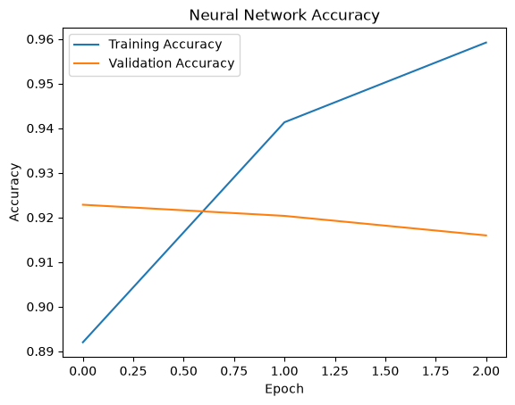
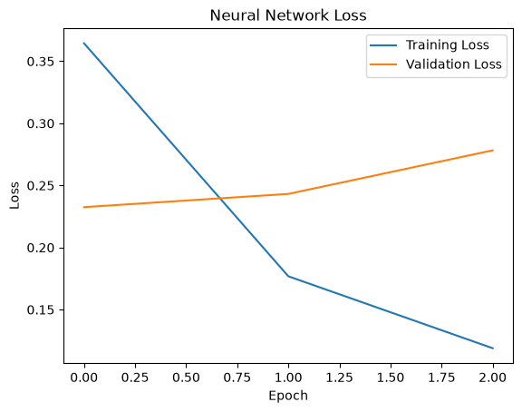
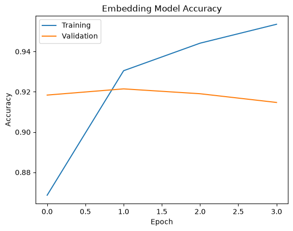
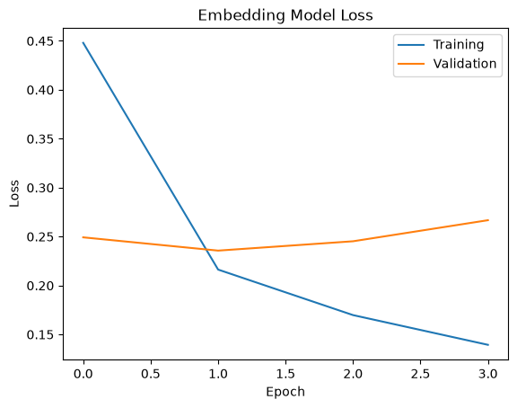
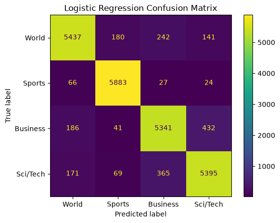
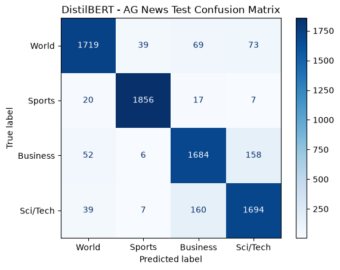
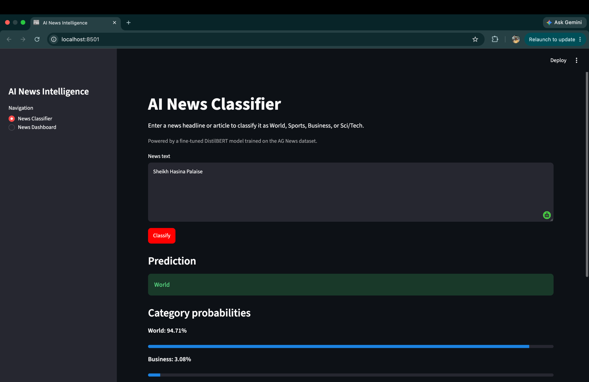
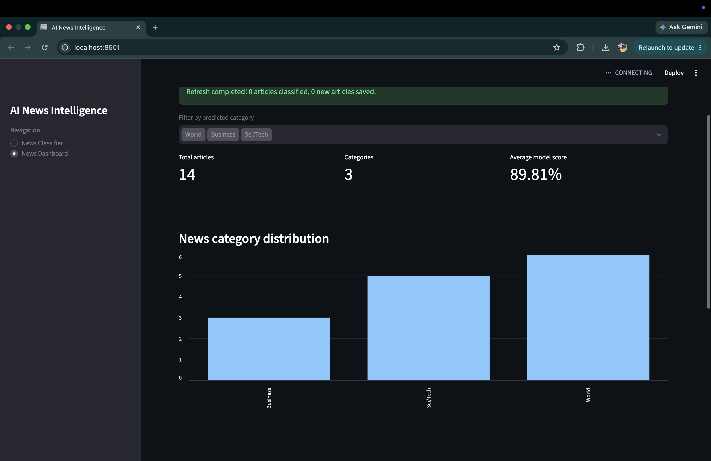
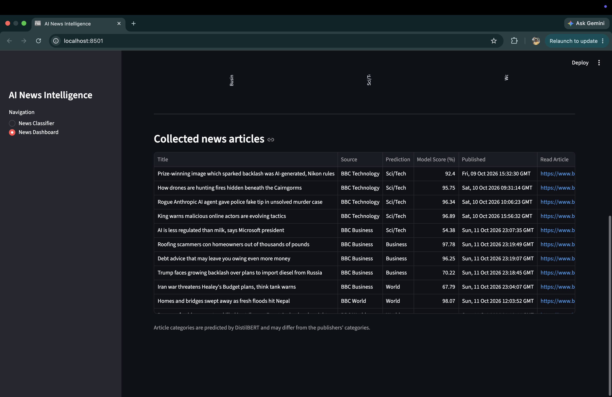

# AI News Intelligence — DistilBERT News Classification

An end-to-end NLP and machine learning project that classifies news articles using a fine-tuned DistilBERT model. The project combines machine learning experimentation, automated news collection, database management, and an interactive web application.

I started this project by exploring different approaches to text classification, from traditional machine learning to neural networks and Transformers. After training and evaluating several models, I expanded the project into a news intelligence application that can collect, classify, and organise news articles from RSS feeds.

## Features

- **News classification:** Classifies text into World, Sports, Business, or Sci/Tech.
- **Fine-tuned DistilBERT:** Uses a Transformer model trained on the AG News dataset.
- **RSS news collection:** Retrieves recent headlines from BBC World, Business, and Technology.
- **Automated classification:** Predicts categories for newly collected headlines.
- **Duplicate prevention:** Avoids processing articles already stored in the database.
- **SQLite database:** Stores article details, predicted categories, and model confidence scores.
- **Interactive dashboard:** Displays article counts, category distribution, and prediction results.
- **Category filtering:** Allows users to explore articles by predicted category.
- **Manual news refresh:** Collects and classifies new articles through the web interface.
- **Hourly scheduling:** Supports automatic news collection while the local scheduler is running.

## Model Development

I experimented with several machine learning and deep learning approaches to understand how different architectures perform on news classification.

The dataset used was **AG News**, which contains four categories:

1. World
2. Sports
3. Business
4. Sci/Tech

### Model Performance Comparison

| Model | Validation Accuracy | Test Accuracy |
|---|---:|---:|
| TF-IDF + Logistic Regression | 91.90% | — |
| TF-IDF + Neural Network | 92.28% | — |
| Learned Embedding Neural Network | 92.15% | 91.75% |
| Fine-tuned DistilBERT | 92.10% | 91.49% |

The fine-tuned DistilBERT model was evaluated on the official AG News test set containing 7,600 unseen articles.

Although DistilBERT did not achieve the highest accuracy among the models tested, it allowed me to explore Transformer fine-tuning, contextual text representations, tokenisation, and PyTorch inference.

## Model Training and Evaluation

### 1. Neural Network Training

I trained a neural network using TF-IDF features to explore whether a neural architecture could improve text classification performance.

The following graphs show the training and validation accuracy and loss over three epochs.

The training accuracy improved with each epoch, while validation accuracy gradually decreased. This suggests the model was beginning to overfit the training data.

**Training and Validation Accuracy**



**Training and Validation Loss**



### 2. Embedding-Based Neural Network

I also experimented with a neural network that learns word embeddings directly from the training data.

The model achieved 92.15% validation accuracy and 91.75% accuracy on the official test set.

The graphs show that training performance continued improving, while validation performance peaked earlier and then declined slightly.

**Embedding Model Accuracy**



**Embedding Model Loss**



### 3. Logistic Regression Evaluation

Logistic Regression with TF-IDF features was used as a traditional machine learning baseline.

It achieved 91.90% validation accuracy.

The confusion matrix below shows its predictions across the four AG News categories.



### 4. DistilBERT Fine-Tuning and Evaluation

For the final application, I fine-tuned `distilbert-base-uncased` using PyTorch and Hugging Face Transformers.

The fine-tuning experiment used:

- 8,000 training articles
- 2,000 validation articles
- Four news categories

After training, the model was evaluated on the official AG News test set of 7,600 unseen articles.

**Final DistilBERT test accuracy: 91.49%**

The confusion matrix shows strong classification performance across the four categories, with the most noticeable confusion between Business and Sci/Tech.



## Application Screenshots

### News Classifier

The News Classifier allows users to enter a headline or article and receive a predicted category with probability scores.



### News Analytics Dashboard

The dashboard provides an overview of collected news articles, predicted category distribution, and average model confidence.



### Collected News Articles

Collected articles are displayed in a table with their source, predicted category, model score, publication date, and a link to the original article.



## How the News Intelligence Pipeline Works

The application connects several components to automatically process news articles.

**Pipeline workflow:**

1. Collect recent news articles from BBC RSS feeds.
2. Extract the headline, source, publication date, and article link.
3. Check whether the article has already been processed.
4. Skip duplicate or previously saved articles.
5. Classify new headlines using the fine-tuned DistilBERT model.
6. Store the article information and prediction in SQLite.
7. Display the collected data through the Streamlit dashboard.

The application supports both manual news refresh and scheduled collection.

## Technologies Used

| Component | Technology |
|---|---|
| Programming Language | Python |
| Traditional Machine Learning | Scikit-learn |
| Deep Learning | PyTorch |
| NLP and Transformers | Hugging Face Transformers, DistilBERT |
| Data Processing | Pandas |
| News Collection | Feedparser, BBC RSS |
| Database | SQLite |
| Web Application | Streamlit |
| Scheduling | APScheduler |
| Version Control | Git, GitHub |

## Project Structure

```text
ai-text-classifier/
├── app.py
├── src/
│   ├── predict.py
│   ├── news_collector.py
│   ├── news_pipeline.py
│   ├── database.py
│   └── scheduler.py
├── models/
│   └── distilbert_agnews/
├── data/
│   └── news.db
├── screenshots/
│   ├── neural_network_accuracy.png
│   ├── neural_network_loss.png
│   ├── embedding_accuracy.png
│   ├── embedding_loss.png
│   ├── logistic_regression_confusion_matrix.png
│   ├── distilbert_confusion_matrix.png
│   ├── classifier.png
│   ├── dashboard.png
│   └── articles.png
├── requirements.txt
├── .gitignore
└── README.md
```

The structure above highlights the main application components. Additional model development and experimentation files may also be included in the repository.

The trained model files and local SQLite database are excluded from GitHub.

## Installation and Local Setup

### 1. Clone the Repository

```bash
git clone https://github.com/Zobair2345/ai-text-classifier.git
cd ai-text-classifier
```

### 2. Create a Virtual Environment

```bash
python3 -m venv venv
source venv/bin/activate
```

### 3. Install Dependencies

```bash
python -m pip install -r requirements.txt
```

### 4. Configure the Trained Model

The application currently expects the fine-tuned DistilBERT model and tokenizer files in:

```text
models/distilbert_agnews/
```

These files are not included in the GitHub repository and must be supplied separately before running the classifier.

### 5. Run the Streamlit Application

```bash
python -m streamlit run app.py
```

Open the local address displayed in the terminal, usually:

```text
http://localhost:8501
```

### 6. Run the News Collection Pipeline

```bash
python -m src.news_pipeline
```

This retrieves articles from the configured RSS feeds, classifies new headlines, and saves their predictions to SQLite.

### 7. Run the Hourly Scheduler

```bash
python -m src.scheduler
```

The scheduler runs the news collection pipeline immediately and then repeats it every hour.

The scheduler requires the Python process to remain running and the computer to stay awake.

On some macOS systems, RSS access may require configuring the Python SSL certificate bundle.

## Current Limitations

The project currently runs locally and has several areas for future improvement.

- The trained DistilBERT model is not yet publicly hosted.
- SQLite stores data locally rather than in a cloud database.
- Scheduled collection only runs while the scheduler process is active.
- The classification pipeline currently uses RSS headlines rather than full article content.
- Predictions may differ from publishers' categories.
- Prediction confidence does not indicate whether an article is accurate or trustworthy.
- Performance on live news headlines may differ from performance on the AG News test dataset.

## Future Improvements

I plan to extend the application with:

- Hugging Face Hub hosting for the trained DistilBERT model.
- Cloud deployment of the Streamlit application.
- Persistent database storage.
- Cloud-based scheduled news collection.
- Additional RSS news sources.
- Historical news trends and improved analytics.
- Article summarisation and more advanced NLP features.

## What I Learned

This project helped me understand how to move from model experimentation to building a complete machine learning application.

I worked with traditional machine learning, neural networks, word embeddings, Transformer fine-tuning, model evaluation, data pipelines, database storage, and web application development.

One important lesson was that using a more complex model does not necessarily guarantee better accuracy. Comparing different architectures helped me understand the importance of evaluation and choosing models based on experimental results rather than complexity alone.

Building the RSS collection pipeline and dashboard also gave me practical experience connecting machine learning with real-world data and automation.

## Author

**Zobair Abdullah**

Bachelor of Computer Science — Big Data and AI

GitHub: https://github.com/Zobair2345